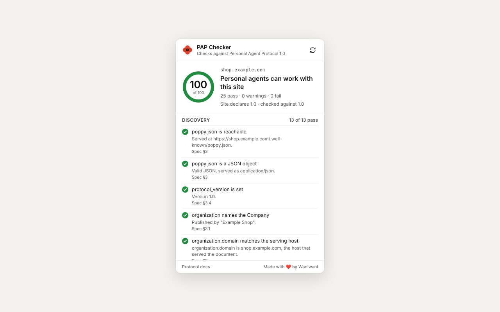
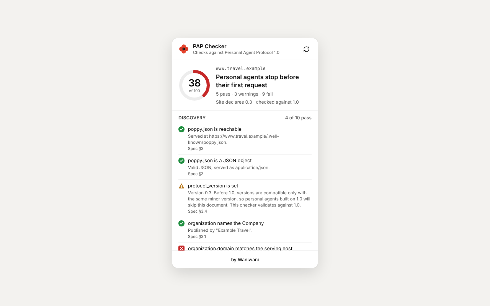
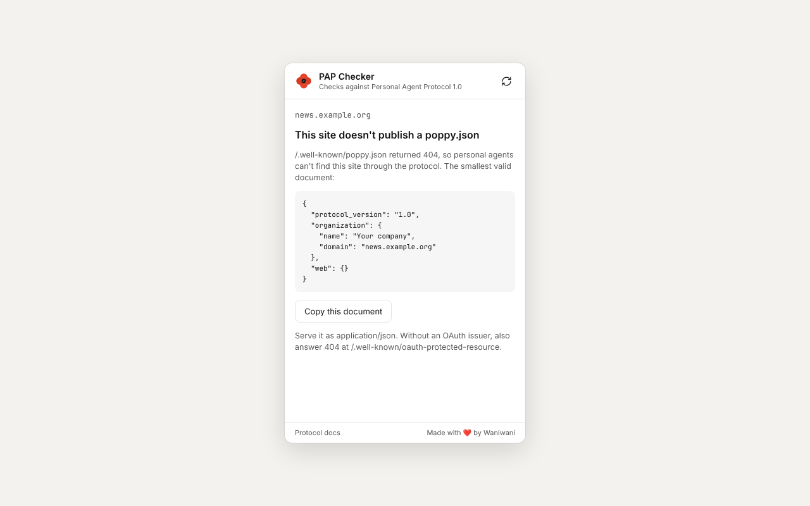

<div align="center">


# PAP Checker

**Score any website for the [Personal Agent Protocol](https://personalagentprotocol.org) 1.0 in one click.**

[](https://github.com/WaniWani-AI/pap-checker/releases/latest)
[](https://personalagentprotocol.org/docs/spec)
[](extension/manifest.json)
[](LICENSE)

[Install](#install) · [Check a site on the web](https://waniwani.ai/pap-checker) · [What it checks](#what-it-checks) · [Privacy](#privacy)

</div>

<br>

| Ready | Problems found | No poppy.json |
| :---: | :---: | :---: |
|  |  |  |

Personal agents such as Meta's Muse now look for a `poppy.json` on every site they visit. Publishing one is the easy part. What breaks in practice sits behind it: an issuer that doesn't list the domain back, a `www` host the file doesn't name, an endpoint that accepts any Session header. A file can look right and still have a conforming agent stop before its first request.

PAP Checker reads a site the way the 1.0 spec tells a personal agent to, then calls every interface it finds. Click the icon for the score, every check, its spec section and what to fix. Turn on automatic scores and sites that publish a `poppy.json` get their score on the icon as you browse.

## Try it in 10 seconds

No install needed. Check any domain on the web:

**[waniwani.ai/pap-checker](https://waniwani.ai/pap-checker)**

or from a terminal, the same report as JSON:

```bash
curl "https://www.waniwani.ai/api/pap-checker?domain=www.waniwani.ai"
```

`www.waniwani.ai` scores 100: 12 of 12 checks pass, including an MCP server that answers a call signed as a personal agent.

## Install

From the Chrome Web Store once the listing is live, or by hand today:

1. Download `pap-checker-<version>.zip` from the [latest release](https://github.com/WaniWani-AI/pap-checker/releases/latest) and unzip it.
2. Open `chrome://extensions` and turn on **Developer mode**.
3. Click **Load unpacked** and pick the unzipped folder.

## What it checks

The checks follow the order a personal agent works in, so the first failure is the one that stops an agent.

| Group | What gets checked |
| --- | --- |
| **Discovery** | `/.well-known/poppy.json` at the exact path, redirects that stay on HTTPS, `organization.domain` against the host that served the file (`www` and the apex are different hosts), required fields, scope hints, extensions and every `supported_versions` document. |
| **Sign-in** | The protected resource metadata, the issuer it names, and the issuer's own metadata listing the domain back in `protected_resources`. |
| **Interfaces** | An MCP `initialize` on each MCP server, a load of each OpenAPI description, the tasks endpoint and the browser-session page. |
| **Session header** | The checker acts as a personal agent with published client metadata and keys. It signs a Session JWT for each call, then sends a forged one and an unsupported `Poppy-Version`, which a conforming endpoint has to refuse. |

### The score

A pass counts 1 and a warning 0.5, over the checks that ran. Skipped checks don't count. A failure in discovery or sign-in caps the score at 40, because a personal agent stops there and never reaches the interfaces that passed.

| Score | Badge | Meaning |
| --- | --- | --- |
| 90 to 100 | green | Personal agents can work with the site. |
| 60 to 89 | amber | Agents get in, but some interfaces fail. |
| 0 to 59 | red | A conforming agent stops before its first request. |

## Privacy

The extension installs with narrow permissions: the current tab when you click its icon, and the checker on `waniwani.ai`. Click the icon on any site to check it. That sends the site's hostname to `https://www.waniwani.ai/api/pap-checker`, which runs the checks and returns the report.

Automatic scores are opt-in. Click **Turn on** in the popup and Chrome asks for access to HTTPS sites. From then on, the extension asks each site you visit for its own public `/.well-known/poppy.json`, without cookies, and only sends the hostname to the checker when the site answers with a real Poppy document. Most of the web has no such file, so most sites never reach Waniwani. IP addresses, `localhost` and private names such as `*.local` or `*.corp` are never checked automatically. You can turn it off again from the extension's site access settings in Chrome.

Results stay in session storage for 30 minutes, which is why the popup opens instantly, and they're cleared when the browser closes. No page content, cookies or user identifier ever leave the browser. Full policy in [PRIVACY.md](PRIVACY.md).

## Develop

Plain HTML, CSS and JavaScript in [`extension/`](extension), with no build step. Load the folder unpacked to try a change.

```bash
./scripts/build.sh                 # dist/pap-checker-<version>.zip
node scripts/render-assets.cjs     # icons and store screenshots (needs Playwright)
```

The checks themselves run in the [checker API](https://waniwani.ai/pap-checker) behind the extension. Found a check that disagrees with the spec, or one that's missing? [Open an issue](https://github.com/WaniWani-AI/pap-checker/issues) with the domain and the spec section, and we'll fix it.

## Release

Bump `version` in `extension/manifest.json`, then run the **Release** workflow on `main` from the Actions tab, or push a matching tag (`git tag v1.2.0 && git push origin v1.2.0`). The [workflow](.github/workflows/release.yml) builds the zip, creates the tag and the GitHub release, and publishes to the Chrome Web Store when the `CWS_EXTENSION_ID`, `CWS_PUBLISHER_ID`, `CWS_CLIENT_ID`, `CWS_CLIENT_SECRET` and `CWS_REFRESH_TOKEN` secrets are set.

## About

Made with ❤️ by [Waniwani](https://waniwani.ai), the AI distribution platform.

PAP Checker is a community tool. It isn't affiliated with Sierra, Meta or the Personal Agent Protocol project, and the names Personal Agent Protocol and Poppy belong to their owners. MIT licensed, see [LICENSE](LICENSE).
